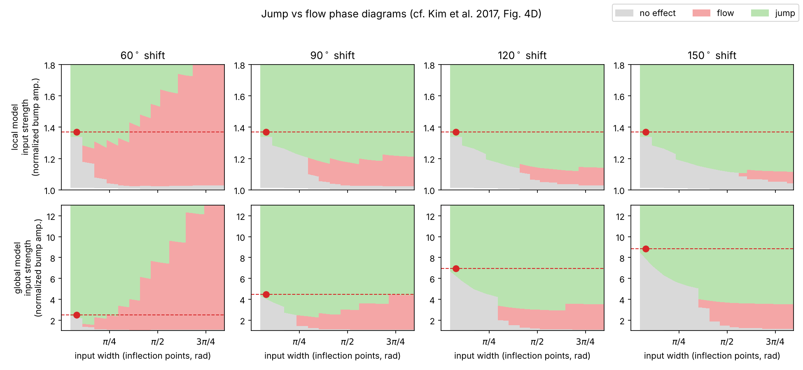

# 🪰🧭 Ring attractor dynamics in the *Drosophila* central brain: a reproduction

Computational Neuroscience final project · **Julia, Luiz & Elizabeth** · presentation **15 Dec 2026**

We study and partially reproduce
> Kim S.S., Rouault H., Druckmann S., Jayaraman V. (2017). *Ring attractor dynamics in the Drosophila central brain.* **Science** 356, 849–853. [doi:10.1126/science.aal4835](https://doi.org/10.1126/science.aal4835)

**The paper in one paragraph.** A fly keeps track of which way it is facing using a population of neurons (E-PG neurons) arranged like a ring in the *ellipsoid body*. Activity forms a single "bump" whose position on the ring *is* the fly's heading. Theory had long predicted that such a **ring attractor** network should exist. This paper shows experimentally that it does: the bump is unique, it persists in darkness, and if you use a laser to create an artificial bump, the network adopts it and kills the old one. By comparing how the bump **jumps** or **flows** after sudden input changes with two models, they conclude the connectivity is **local excitation + flat global inhibition**.

---

## 🚀 Start here (everyone, day 1)

```bash
git clone https://github.com/juliavikr/ring-attractor-kim2017.git
cd ring-attractor-kim2017
python -m venv .venv && source .venv/bin/activate      # Windows: .venv\Scripts\activate
pip install -r requirements.txt
pytest -q                                               # should say "13 passed"
jupyter lab notebooks/01_tutorial_first_bump.ipynb      # do the tutorial!
```

Then open **[PLAN.md](PLAN.md)**. It has the full checklist, who does what, and the deadlines.

## 🗺️ What's in this repository

```
├── PLAN.md                    ← 📋 THE PLAN: checklist, roles, timeline (tick boxes here)
├── src/ring_model.py          ← the model (commented line by line, read it!)
├── notebooks/
│   └── 01_tutorial_first_bump.ipynb   ← start here: build your first ring attractor
├── scripts/                   ← one script per paper figure we reproduce
│   ├── fig1_tracking_and_darkness.py   TODO  (Julia)
│   ├── fig2_competition.py             TODO  (Elizabeth)
│   ├── fig3_drift.py                   TODO  (Elizabeth)
│   ├── fig4_jump_vs_flow.py            ✅ working example (Luiz explains it)
│   └── fig4G_jump_threshold.py         TODO  (Luiz)
├── tests/test_model.py        ← `pytest -q` checks the model still matches the paper
├── figures/                   ← PNGs produced by the scripts
├── results/RESULTS_LOG.md     ← what we found, figure by figure
├── docs/
│   ├── LEARNING_GUIDE.md      ← background for complete beginners + resources
│   ├── PAPER_NOTES.md         ← reading guide, figure-by-figure summary, our notes
│   ├── MODEL.md               ← the equations and how our code maps to the authors' code
│   ├── PRESENTATION_OUTLINE.md← 20-min talk, slide by slide, with timings
│   ├── GIT_WORKFLOW.md        ← git for beginners: branch → commit → PR → review
│   └── meetings/              ← meeting notes (template + kickoff)
├── data/README.md             ← how to get the original Janelia data (optional)
├── papers/                    ← put the PDF here locally (git-ignored: copyrighted)
└── tools/setup_github.sh      ← creates issues, labels & milestones on GitHub
```

## 🎯 Which figures we reproduce

| Paper figure | What it shows | Our script | Owner | Status |
|---|---|---|---|---|
| Fig. 1G–K | bump tracks visual cue, persists in darkness | `fig1_tracking_and_darkness.py` | Julia | ⬜ |
| Fig. 2C–F | artificial bump replaces the old one (competition) | `fig2_competition.py` | Elizabeth | ⬜ |
| Fig. 3B–D | artificial bump drifts gradually (not WTA) | `fig3_drift.py` | Elizabeth | ⬜ |
| Fig. 4A–B | example of bump *flow* vs *jump* | `fig4_jump_vs_flow.py` | Luiz | ✅ |
| **Fig. 4D** | **jump/flow phase diagrams: local vs global model** | `fig4_jump_vs_flow.py` | Luiz | ✅ |
| Fig. 4G | jump threshold independent of distance → local model | `fig4G_jump_threshold.py` | Luiz | ⬜ |

(Update the Status column as you go: ⬜ not started · 🟨 in progress · ✅ done)

**Preview: our Fig. 4D already reproduces the paper's key model result.** In the local model, a narrow input needs the same strength to make the bump jump whatever the shift distance (flat red line). In the global model it needs much more, and more for every extra degree of shift.



3. Repo **Settings → Collaborators** → invite Luiz and Elizabeth.
4. Optional but recommended: install the [GitHub CLI](https://cli.github.com/), run `gh auth login`, then
   `bash tools/setup_github.sh` to create all tasks as **Issues** grouped in 3 **Milestones** (M1/M2/M3).
   Then make a **Project board** (repo → Projects → New → Board) and add the issues. You'll see To do / In progress / Done at a glance.

## 📚 Credits
- Original model code: [hrouault/RingAttractor](https://github.com/hrouault/RingAttractor) (C++, © 2016 HHMI, BSD-3). Our `src/ring_model.py` is a simplified Python translation; see [NOTICE](NOTICE).
- Original data: [Janelia download page](https://research.janelia.org/jayaraman/KimRouaultScience2017_Downloads/).
